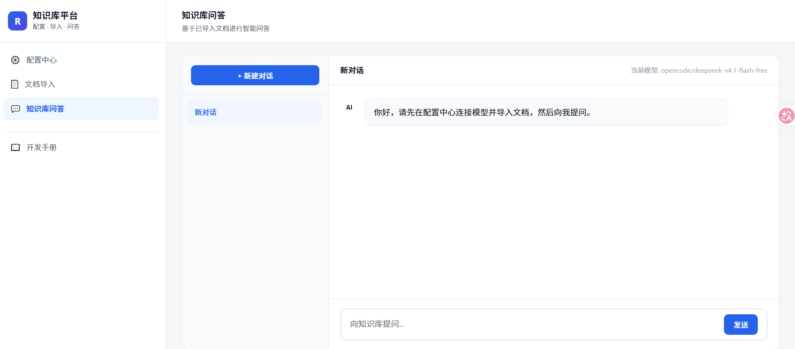

# OpenRAG Studio

**OpenRAG Studio** 是一款本地化部署的企业级检索增强生成（RAG）知识库平台。它深度集成了本地大语言模型服务（OpenCode）与向量数据库（ChromaDB），帮助用户轻松将私有文档转化为智能资产，实现安全、精准、具备上下文记忆的知识问答。

## 📖 详细业务功能描述

OpenRAG Studio 包含四大核心业务模块，覆盖了从模型调测、知识入库到智能问答的完整生命周期。

### 1. 配置中心 (Configuration Center)
配置中心是系统运行的基础，提供开箱即用的底层服务接入能力。
- **OpenCode 服务与模型管理**：支持自动检测本地 OpenCode 服务的连通性。连接成功后，系统会自动拉取服务端提供的**免费大语言模型列表**，用户可直接在下拉菜单中一键选择并应用所需模型，配置实时同步至后端。
- **对话调测台**：内置轻量级对话窗口。在正式使用知识库前，用户可在此直接与大模型进行收发测试，验证模型推理与网络连通能力。
- **向量数据库探活**：系统启动时及操作期间，自动对本地 ChromaDB 发起心跳检测，实时展示连接状态，保障数据存取链路的畅通。

### 2. 文档导入与知识管理 (Document Ingestion & Management)
将非结构化文档高效转化为大模型可理解的向量数据，并支持后续的数据治理。
- **多格式文档解析**：支持 PDF、Word (DOCX) 和纯文本 (TXT) 文件的拖拽上传（单文件最大 20MB）。
- **可视化切片配置**：提供向导式的文档切片（Chunking）功能。用户可自定义 `Chunk Size`（切片大小）和 `Chunk Overlap`（重叠长度），并实时预览切片效果，以确保最佳检索精度。
- **一键向量化入库**：确认切片后，系统将自动调用 Embedding 模型完成向量化，并写入向量数据库，全程提供可视化进度追踪。
- **知识库资产看板**：提供已导入文档的列表管理，用户可随时查看任意文档的具体切片明细，并支持**一键彻底删除**文档及其关联的所有向量数据，确保知识库的纯净与时效性。

### 3. 多会话智能问答 (Multi-session Intelligent Q&A)
基于 RAG 技术的核心交互界面，提供类 ChatGPT 的丝滑体验。
- **多会话隔离与持久化**：支持创建、切换和删除多个独立的对话窗口。所有对话历史自动保存在浏览器本地（LocalStorage），刷新或关闭页面均不丢失，方便用户按不同业务主题管理对话。
- **上下文记忆 (Contextual Memory)**：系统自动维护当前会话的上下文，每次提问时携带最近轮次的历史记录，使大模型能够理解追问意图，实现连贯的多轮对话。
- **流式打字机输出**：答案以逐字流式（Streaming）方式输出，带来极佳的阅读体验。并配有“正在检索知识库”和“正在思考并生成”的呼吸灯提示，消除等待焦虑。
- **检索增强生成 (RAG)**：系统自动将用户问题向量化，在知识库中召回最相关的片段，作为参考资料拼接至 Prompt 中，从根本上降低大模型的幻觉，回答更精准。

### 4. 内置开发手册 (Developer Manual)
- **零门槛上手**：系统内置了详尽的开发者与运维手册，涵盖环境准备、依赖安装、后端启动、配置指南及常见问题排查（FAQ），帮助团队成员快速接手和维护项目。